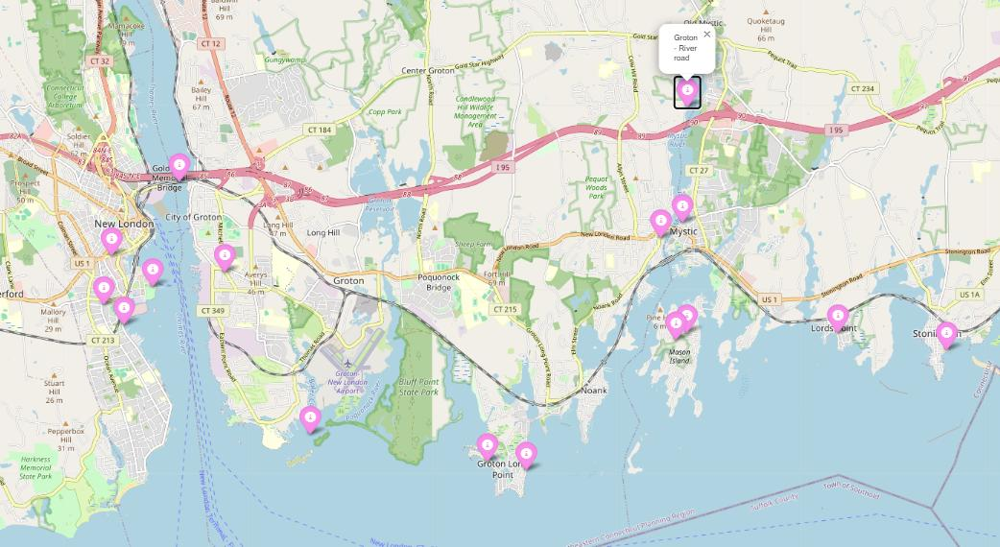
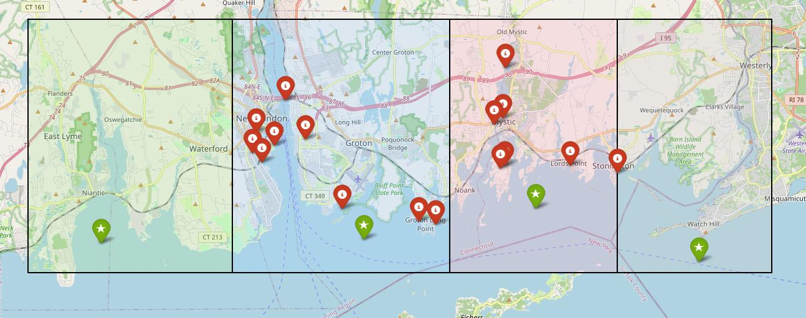
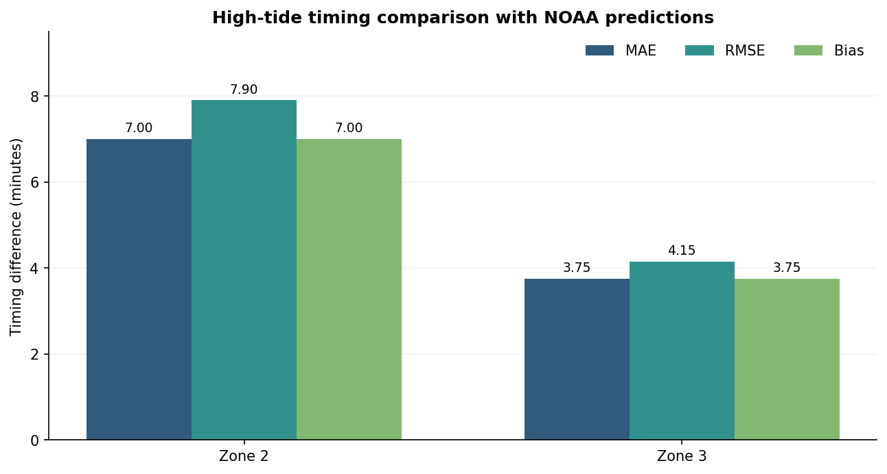

# Coastal High-Tide Detection & Validation

**Python · Statistical analysis · Geospatial mapping · Time-series validation**

I built an automated, zone-aware framework to identify unusually high modeled tides and connect them to coastal monitoring sites in Connecticut. The project combines statistical event selection, geographic analysis, and a comparison with NOAA tide predictions.

**Role:** Graduate Research Assistant, Connecticut Institute for Resilience and Climate Adaptation (CIRCA)  
**Research and implementation:** Hiral Choksi  
**Advisor:** Dr. Yaprak Onat

## Project at a glance

- **4 tidal zones** analyzed using hourly modeled water levels.
- **16 coastal monitoring sites** connected to tidal zones across Groton, New London, and Stonington.
- **2 zones** compared with NOAA-predicted high-tide times.
- **3.75 and 7.00 minutes:** reported mean absolute timing differences for Zones 3 and 2, respectively.

## The challenge

Coastal areas do not experience tides in the same way. A single regional cutoff can leave lower-range tidal zones with few or no selected events. This project explores a zone-aware selection strategy that connects high-water candidates to locations used for coastal monitoring.

## My contribution

I independently developed the analysis, from preparing the tidal data and designing the event-selection logic to mapping sites, checking zone assignments, comparing predictions, and presenting the results.

## Workflow

1. **Prepare tidal data:** standardize hourly modeled water levels across four zones.
2. **Identify high-water candidates:** calculate a monthly regional 90th-percentile threshold.
3. **Adapt by zone:** apply fallback thresholds when a zone produces too few candidates.
4. **Map monitoring sites:** assign 16 locations to zones and check against nearest-zone distances.
5. **Compare timing:** match selected events to NOAA-predicted high tides on the same day.

## Monitoring locations and tidal zones

The framework connects modeled tidal zones with 16 monitoring points in southeastern Connecticut.

*Monitoring-site map from the high-tide report. The original map is interactive; this is a static image.*

| Town | Monitoring points named in the report |
|---|---|
| Stonington | Downtown Mystic; Lord's Point; Rte 1 (Bike store); Mason's Land (two points); Dodge Paddock |
| Groton | Jupiter Point; River road; Underpass near airport; Groton Long Point (two points); Five corners |
| New London | Fort Trumbull; Greens Harbor Beach – Fort Trumbull; Bank Street; Intersection of Montauk and Bank |

The two repeated names represent distinct monitoring points in the report. These locations are linked to **zone-specific modeled tide predictions**.

*Zone geofences, zone centroids (green stars), and monitoring points (red markers), reproduced from the report.*

## Results: timing comparison

| Validation zone | Mean absolute difference | Root mean square difference | Reported bias |
|---|---:|---:|---:|
| Zone 2 | 7.00 min | 7.90 min | +7.00 min |
| Zone 3 | 3.75 min | 4.15 min | +3.75 min |

*Metrics are reproduced from the project report and compare model times with NOAA **predictions**, not observed flood events. The report describes positive bias as the model predicting earlier than NOAA. Its references to the validation period differ, so the period and sample size still need confirmation.*

### Additional findings from the report

- **Coverage across locations:** all 16 monitoring sites received the same zone assignment from the geofence and nearest-zone checks.
- **Why adaptive thresholds mattered:** in the report's December 2025 example, the regional threshold produced one exceedance in Zone 2 and none in Zone 3. After zone-specific fallback, both had at least three selected events.
- **Timing differences:** the report describes differences of 2–11 minutes for Zone 2 and 1–6 minutes for Zone 3 in the comparison illustrated.

These are reported project findings; selection counts and timing comparisons should be interpreted in the context of the specified analysis and the validation-period uncertainty above.

## Skills demonstrated

**Data science:** data cleaning, percentile-based event selection, statistical validation, time-series visualization  
**Geospatial analysis:** location data preparation, spatial classification, distance checks, mapping  
**Communication:** research reporting, visual explanation, and interpretation of results

## Research context

This work was completed at CIRCA under the guidance of Dr. Yaprak Onat. Source code is not included in this public showcase.

**Acknowledgment:** Supported by Connecticut Sea Grant, CIRCA, and CT NERR.
